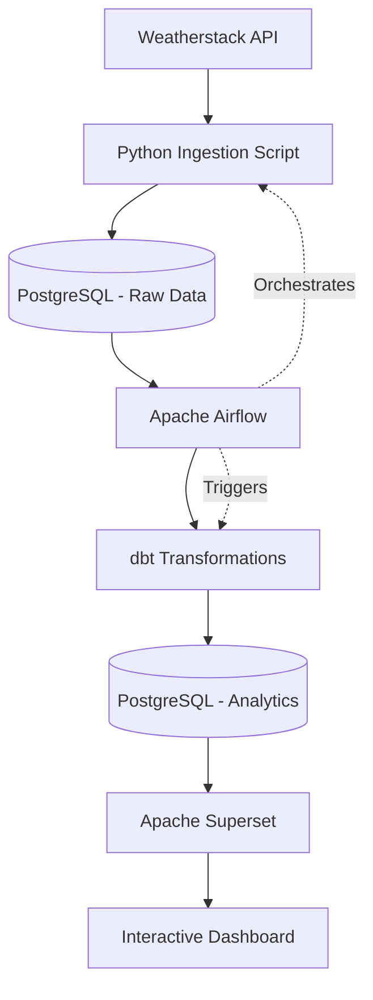

# 🌦️ WeatherFlow-ELT

**An automated end-to-end ELT pipeline for near-real-time weather data ingestion, transformation, orchestration, and visualization.**

WeatherFlow-ELT is a Data Engineering project that collects live weather data from the Weatherstack API, stores raw data in PostgreSQL, transforms it using dbt, orchestrates workflows with Apache Airflow, and delivers interactive analytics through Apache Superset.

The entire infrastructure runs using Docker containers within **WSL 2 (Ubuntu 24.04) on Windows**.

## 🎯 Project Objectives

- Ingest live weather data from an external REST API.
- Build an automated and scheduled data ingestion pipeline.
- Store raw weather data in PostgreSQL.
- Transform and model data using dbt.
- Orchestrate ingestion and transformation workflows with Apache Airflow.
- Build interactive dashboards using Apache Superset.
- Containerize services and manage dependencies using Docker Compose.

## 🏗️ Architecture



## 🛠️ Technology Stack

| Technology | Purpose |
|---|---|
| WSL 2 / Ubuntu 24.04 | Linux development environment |
| Docker | Containerization |
| Docker Compose | Multi-container orchestration |
| Python | API ingestion and data processing |
| Weatherstack API | Live weather data source |
| PostgreSQL | Data storage |
| psycopg2 | Python–PostgreSQL connectivity |
| Apache Airflow 3.0 | Workflow orchestration |
| dbt | Data transformation and modeling |
| Apache Superset | Data visualization and dashboards |

## 🔄 ELT Pipeline Workflow

### 1. Data Ingestion – Weatherstack API

- Connect to the Weatherstack REST API.
- Send HTTP requests to retrieve weather information.
- Process API responses using Python.
- Handle API responses and prepare structured records for storage.

### 2. Data Storage – PostgreSQL

- Deploy PostgreSQL using Docker Compose.
- Establish database connections using `psycopg2`.
- Load raw weather data into PostgreSQL tables.
- Maintain a centralized storage layer for downstream transformations.

### 3. Workflow Orchestration – Apache Airflow

- Deploy Apache Airflow 3.0 using Docker Compose.
- Create DAGs to automate data ingestion.
- Define task dependencies and execution order.
- Schedule recurring ingestion workflows.
- Monitor DAG runs and task execution through the Airflow UI.

### 4. Data Transformation – dbt

- Configure dbt to connect to PostgreSQL.
- Create SQL-based transformation models.
- Organize raw data into analytical models.
- Prepare structured datasets for reporting and visualization.

### 5. Analytics and Visualization – Apache Superset

- Deploy Apache Superset using Docker.
- Connect Superset to PostgreSQL.
- Explore analytical datasets.
- Create charts and visualizations.
- Build an interactive near-real-time weather dashboard.

## ⚙️ Environment Setup

### Prerequisites

- Windows with WSL 2.
- Ubuntu 24.04.
- Visual Studio Code with WSL extension.
- Docker Desktop with WSL integration enabled.
- Docker Compose.
- Weatherstack API key.

### 1. Set up WSL Ubuntu

Open Ubuntu through WSL and verify the installation:

```bash
wsl --version
docker --version
docker compose version
```

### 2. Configure the Weatherstack API

Create an account at [Weatherstack](https://weatherstack.com/) and obtain an API access key.

Store your API key in an environment variable or an environment configuration file.

**Never commit API keys or credentials to GitHub.**

### 3. Start the infrastructure

Use Docker Compose to build and start the required services:

```bash
docker compose up -d
```

Check running containers:

```bash
docker compose ps
```

The exact Compose configuration and startup commands depend on the service definitions in the repository.

## 📁 Project Structure

```text
WeatherFlow-ELT/
│
├── airflow/
│   ├── dags/
│   │   ├── weather_ingestion_dag.py
│   │   └── dbt_transformation_dag.py
│   └── docker-compose.yaml
│
├── ingestion/
│   ├── api_request.py
│   └── load_postgres.py
│
├── dbt/
│   ├── models/
│   │   ├── staging/
│   │   └── marts/
│   ├── dbt_project.yml
│   └── profiles.yml
│
├── postgres/
│
├── superset/
│
├── docker-compose.yaml
├── .env.example
├── .gitignore
└── README.md
```

*Illustrative structure: adapt it to the actual repository files.*

## 📊 Expected Outcome

The final pipeline connects all the components into an automated data workflow:

- Automated extraction of weather data from an external API.
- Centralized storage in PostgreSQL.
- Scheduled workflow execution using Airflow.
- SQL-based transformations using dbt.
- Interactive weather analytics using Superset.

The dashboard is designed for near-real-time monitoring through periodically refreshed data, rather than continuous streaming.

## 🎓 Learning Outcomes

This project provides practical experience with:

- End-to-end ELT pipeline architecture.
- REST API integration and data ingestion.
- Relational databases and SQL.
- Apache Airflow DAGs and task dependencies.
- dbt data modeling and transformations.
- Docker-based infrastructure.
- Data visualization and BI dashboards.
- Integration of multiple Data Engineering technologies.

## 🚀 Future Improvements

- Implement incremental data loading.
- Add data quality checks and validation.
- Introduce logging, retries, and failure notifications.
- Improve dbt testing and documentation.
- Optimize PostgreSQL queries and indexing.
- Enhance dashboard refresh and monitoring.
- Add CI/CD automation for pipeline deployment.

## 📚 Learning Resource

This project is based on the tutorial:

**Building an Automated ELT Pipeline: API → Airflow → PostgreSQL → dbt → Superset**

By Calvin Yoon.

- Published: May 10, 2025.
- [Watch the full tutorial on YouTube](https://www.youtube.com/watch?v=YOUR_VIDEO_ID)

---

**WeatherFlow-ELT — From live API data to actionable weather insights.** 🌦️
