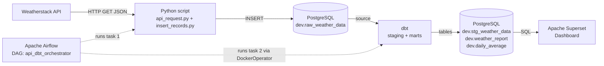

# 🌦️ Weather Data Pipeline

An end-to-end, fully containerized data engineering project that collects near real-time weather data from an API, stores it in PostgreSQL, transforms it with dbt, orchestrates everything with Apache Airflow, and visualizes it in Apache Superset.

Everything runs inside **Docker containers**: nothing except Docker itself is installed on your machine.

---

## 📑 Table of Contents

1. [Overview](#1-overview)
2. [Architecture](#2-architecture)
3. [Tech Stack & Definitions](#3-tech-stack--definitions)
4. [Project Structure](#4-project-structure)
5. [Data Source: Weatherstack API](#5-data-source-weatherstack-api)
6. [Component Deep Dive](#6-component-deep-dive)
   - [6.1 Python ingestion scripts](#61-python-ingestion-scripts)
   - [6.2 PostgreSQL](#62-postgresql)
   - [6.3 Apache Airflow](#63-apache-airflow)
   - [6.4 dbt](#64-dbt)
   - [6.5 Apache Superset](#65-apache-superset)
   - [6.6 Docker Compose](#66-docker-compose)
7. [Data Model](#7-data-model)
8. [Prerequisites & Environment Setup](#8-prerequisites--environment-setup)
9. [Getting Started](#9-getting-started)
10. [Ports & Credentials Reference](#10-ports--credentials-reference)
11. [Troubleshooting](#11-troubleshooting)
12. [Security Notes](#12-security-notes)
13. [Future Improvements](#13-future-improvements)

---

## 1. Overview

**Goal:** build a small but realistic data platform that demonstrates the full data lifecycle:

| Stage | What happens | Tool |
|---|---|---|
| **Extract** | Fetch current weather for a chosen city from a REST API | Python (`requests`) |
| **Load** | Insert the raw JSON fields into a relational table | Python (`psycopg2`) → PostgreSQL |
| **Transform** | Clean, deduplicate, and aggregate the raw data | dbt |
| **Orchestrate** | Run extract/load then transform automatically on a schedule | Apache Airflow |
| **Visualize** | Dashboard with auto-refresh | Apache Superset |
| **Package** | Run every tool in isolated containers | Docker / Docker Compose |

The pattern used is **ELT** at the database level: raw data is loaded first (`dev.raw_weather_data`), then transformed *inside* the database by dbt.

> ⚠️ This is a first version intended for learning. It is a work in progress and not yet production-ready (see [Future Improvements](#13-future-improvements)).

---

## 2. Architecture



### Execution flow (every N minutes)

1. Airflow's scheduler triggers the DAG `api_dbt_orchestrator`.
2. **Task 1 – `ingest_data_task`** (PythonOperator): calls the Weatherstack API and inserts one record into `dev.raw_weather_data`.
3. **Task 2 – `transform_data_task`** (DockerOperator): spins up a temporary dbt container that runs `dbt run` to rebuild the staging and mart tables.
4. Superset reads the transformed tables and refreshes the dashboard.

Task 2 runs only if Task 1 succeeds (`task1 >> task2`).

### Container topology

All services share one Docker bridge network (`my_network`) so they can reach each other by **service name** (e.g. host `db`) instead of IP address.

```
┌──────────────────────────── Docker network: my_network ─────────────────────────────┐
│                                                                                     │
│  db (Postgres 14.17)  ◄── af (Airflow 3.0.0)  ──spawns──►  dbt (temporary container)│
│       ▲   ▲                    │                                                    │
│       │   └── superset-init    └── mounts /var/run/docker.sock                      │
│       │       superset (3.0.0)                                                      │
│       └────── redis (cache)                                                         │
└─────────────────────────────────────────────────────────────────────────────────────┘
```

---

## 3. Tech Stack & Definitions

| Tool | Version | Definition / role in this project |
|---|---|---|
| **Weatherstack** | Free plan | REST API providing real-time weather data. Free plan = 100 requests/month, 1 location, no historical data. |
| **Python** | 3.12 (Ubuntu 24) | Language used for extraction and loading scripts. |
| **requests** | – | Python HTTP library used to call the API. |
| **psycopg2** (`psycopg2-binary`) | – | Python driver (adapter) for PostgreSQL. |
| **PostgreSQL** | 14.17 | Open-source relational database. Stores raw data, transformed data, and the metadata of Airflow and Superset. |
| **Apache Airflow** | 3.0.0 | Workflow orchestrator. Workflows are written in Python as **DAGs** (Directed Acyclic Graphs): sets of tasks with dependencies and a schedule. |
| **dbt** (data build tool) | `dbt-postgres` | Transformation tool. You write `SELECT` statements ("models"); dbt materializes them as tables/views and manages dependencies between them. |
| **Apache Superset** | 3.0.0-py310 | Open-source BI tool for building charts and dashboards. |
| **Redis** | – | In-memory store used by Superset for caching and async queries. |
| **Docker** | Docker Desktop | Containerization platform: packages applications with their dependencies. |
| **Docker Compose** | – | Tool to define and run multi-container apps from one `docker-compose.yaml`. |
| **WSL 2 + Ubuntu 24** | – | Windows Subsystem for Linux: provides a Linux environment on Windows (dev environment used here). |
| **VS Code** | – | Editor, with the WSL remote extension. |

### Key concepts

- **Container**: a lightweight, isolated process environment started from an *image*.
- **Image**: a read-only template (e.g. `postgres:14.17`) containing the app and its dependencies. The part after `:` is the **tag** (version).
- **Volume / bind mount**: maps a folder on the host to a folder in the container so data/code persists or is shared.
- **Port binding** (`host:container`): e.g. `5000:5432` exposes the container's port 5432 on the host's port 5000.
- **DAG**: Airflow's unit of workflow; Python file describing tasks and their order.
- **Operator**: a template for a task (`PythonOperator` runs a Python function; `DockerOperator` runs a container).
- **dbt model**: a `.sql` file containing a `SELECT`; dbt turns it into a table or view.
- **dbt source**: declaration of a raw table dbt reads from (not created by dbt).
- **Materialization**: how dbt persists a model (`table`, `view`, …).
- **CTE** (Common Table Expression): a named temporary result set defined with `WITH`.
- **Medallion-like layering**: raw → staging (cleaned) → marts (reporting-ready).

---

## 4. Project Structure

```
weather_data_project/
├── api_request/
│   ├── api_request.py          # Fetches data from Weatherstack (+ mock function)
│   └── insert_records.py       # DB connection, table creation, inserts, main()
│
├── airflow/
│   └── dags/
│       └── orchestrator.py     # DAG: ingest (Python) → transform (dbt via Docker)
│
├── dbt/
│   ├── profiles.yml            # dbt connection profile (copied out of the container)
│   └── my_project/
│       ├── dbt_project.yml     # dbt project configuration
│       └── models/
│           ├── sources/
│           │   └── sources.yml           # Declares dev.raw_weather_data
│           ├── staging/
│           │   └── stg_weather_data.sql  # Clean + deduplicate
│           └── mart/
│               ├── weather_report.sql    # Reporting table
│               └── daily_average.sql     # Daily aggregates per city
│
├── docker/
│   ├── docker-init.sh                # Superset initialization script
│   ├── docker-bootstrap.sh           # Superset startup script
│   ├── .env                          # Superset environment variables
│   └── superset_config.py            # Superset Python configuration
│
├── postgres/
│   ├── airflow_init.sql              # Creates airflow user + airflow_db
│   └── superset_init.sql             # Creates superset/examples users + databases
│
├── postgres/data/                    # (auto-created) Postgres data files, bind-mounted
├── .venv/                            # Python virtual environment (not committed)
├── docker-compose.yaml               # Defines all services and the network
└── README.md
```

> Folder names in the file tree reflect the structure used during development; adjust to match your repo (e.g. `.gitignore` should exclude `.venv/`, `postgres/data/`, and secrets).

---

## 5. Data Source: Weatherstack API

- Website: <https://weatherstack.com>
- Endpoint pattern: `http://api.weatherstack.com/current?access_key=<API_KEY>&query=<CITY>`
- Free plan: **100 requests/month**, one location, no full historical data.

Relevant fields of the JSON response:

| JSON path | Meaning | Stored as |
|---|---|---|
| `location.name` | City name | `city` |
| `location.localtime` | Local time at the location | `time` |
| `location.utc_offset` | UTC offset (e.g. `1.0`) | `utc_offset` |
| `current.temperature` | Temperature (°C) | `temperature` |
| `current.weather_descriptions[0]` | Text description (e.g. "Sunny") | `weather_descriptions` |
| `current.wind_speed` | Wind speed | `wind_speed` |

Data is refreshed on the provider side roughly **every 5 minutes**, so polling more often is pointless — and with the free plan quota you must keep a close eye on the number of requests (see [Troubleshooting](#11-troubleshooting)).

---

## 6. Component Deep Dive

### 6.1 Python ingestion scripts

#### `api_request/api_request.py`

- `fetch_data()`
  - Prints `Fetching weather data from Weatherstack API...`.
  - Calls `requests.get(api_url)`.
  - `response.raise_for_status()` raises an exception on HTTP 4xx/5xx.
  - Returns `response.json()` and prints `API response received successfully`.
  - On `requests.exceptions.RequestException`, logs `An error occurred: <e>` and re-raises.
- `mock_fetch_data()`
  - Returns a hard-coded response object identical in shape to the real API output.
  - Used during development to avoid consuming the 100 requests/month quota.
- The API key is stored in a variable (`api_key`) and injected into the URL via an f-string.

#### `api_request/insert_records.py`

Imports `fetch_data` / `mock_fetch_data` from `api_request.py` (this is how Python modules are reused across files).

| Function | Responsibility |
|---|---|
| `connect_to_db()` | Opens a `psycopg2` connection. Returns the connection object. Raises on `psycopg2.Error`. |
| `create_table(conn)` | Creates schema `dev` and table `dev.raw_weather_data` if they don't exist, then commits. |
| `insert_records(conn, data)` | Extracts the needed fields from `data["location"]` and `data["current"]` and inserts one row. `inserted_at` uses `NOW()`. |
| `main()` | Orchestrates: fetch → connect → create table → insert. A `finally` block closes the connection if it exists (`if "conn" in locals()`). |

**Connection parameters — the host/port differ depending on where the code runs:**

| Where the script runs | Host | Port |
|---|---|---|
| Your local machine (WSL) | `localhost` | `5000` (host side of the port binding) |
| Inside the Airflow container | `db` (service name) | `5432` (container port) |

The final version uses `host="db"`, `port=5432` because the script is executed by Airflow inside Docker.

### 6.2 PostgreSQL

- Image: `postgres:14.17`, container name `postgres_container`, service name `db`.
- Port binding: `5000:5432` (the 5000 is deliberately different from 5432 to make the host vs. container distinction obvious).
- Environment variables:
  - `POSTGRES_DB=db`
  - `POSTGRES_USER=db_user`
  - `POSTGRES_PASSWORD=db_password`
- Volumes:
  - `./postgres/data:/var/lib/postgresql/data` → persists database files on your disk.
  - `./postgres/airflow_init.sql:/docker-entrypoint-initdb.d/airflow_init.sql`
  - `./postgres/superset_init.sql:/docker-entrypoint-initdb.d/superset_init.sql`
- **Init scripts**: any `.sql` file in `/docker-entrypoint-initdb.d/` runs **only on the very first initialization** of the data directory. If you change them later, you must delete `postgres/data` (`sudo rm -rf ./postgres/data`) and run `docker compose down -v` before starting again.

Databases and roles created:

| Database | Owner / user | Password | Purpose |
|---|---|---|---|
| `db` | `db_user` | `db_password` | Weather data (raw + dbt models) |
| `airflow_db` | `airflow` | `airflow` | Airflow metadata (~45 tables) |
| `superset_db` | `superset` | `superset` | Superset metadata |
| `examples_db` | `examples` | `examples` | Superset example datasets |

Useful `psql` commands (inside `docker compose exec db psql -U db_user -d db`):

| Command | Meaning |
|---|---|
| `\l` | List databases |
| `\c <dbname>` | Connect to another database |
| `\dn` | List schemas |
| `\dt dev.*` | List tables in schema `dev` |
| `\dv dev.*` | List views in schema `dev` |
| `\q` | Quit |

### 6.3 Apache Airflow

- Image: `apache/airflow:3.0.0`, container `airflow_container`, service `af`.
- Port binding: `8000:8080` → UI at <http://localhost:8000>.
- Command: `bash -c "airflow db migrate && airflow standalone"`
  - `airflow db migrate` creates/updates metadata tables.
  - `airflow standalone` starts all components (scheduler, API server, etc.) in a single process, with an auto-generated admin password printed in the logs (search the logs for `password`).
- Metadata DB connection (environment variable):
  ```
  AIRFLOW__DATABASE__SQL_ALCHEMY_CONN=postgresql+psycopg2://airflow:airflow@db:5432/airflow_db
  ```
- Volumes:
  - `./airflow/dags:/opt/airflow/dags` → DAG files.
  - `./api_request:/opt/airflow/api_request` → makes the ingestion scripts visible inside the container.
  - `/var/run/docker.sock:/var/run/docker.sock` → lets Airflow start Docker containers (needed for `DockerOperator`).
- `group_add: ["<docker socket GID>"]` → gives the container user permission to use the Docker socket (find the GID with `stat -c '%g' /var/run/docker.sock`).
- `depends_on: db` and `networks: my_network`.

#### DAG: `airflow/dags/orchestrator.py`

```python
default_args = {
    "description": "A DAG to orchestrate data",
    "start_date": datetime(2025, 4, 30),
    "catchup": False,
}

with DAG(
    dag_id="api_dbt_orchestrator",
    default_args=default_args,
    schedule=timedelta(minutes=5),
) as dag:
    task1 = PythonOperator(
        task_id="ingest_data_task",
        python_callable=safe_main_callable,
    )
    task2 = DockerOperator(
        task_id="transform_data_task",
        image="<dbt-postgres image>",
        command="run",
        working_dir="/usr/app",
        mounts=[
            Mount(source="<abs path>/dbt/my_project", target="/usr/app", type="bind"),
            Mount(source="<abs path>/dbt/profiles.yml", target="/root/.dbt/profiles.yml", type="bind"),
        ],
        network_mode="weather_data_project_my_network",
        docker_url="unix://var/run/docker.sock",
        auto_remove="success",
    )
    task1 >> task2
```

Important details:

- **`sys.path.append("/opt/airflow/api_request")`** is required so the DAG can `import` the ingestion module.
- **`safe_main_callable`** wraps the import and call of `main()` inside a function so the module is not executed while Airflow parses the DAG file (importing at top level caused the DAG to disappear).
- **`catchup=False`**: Airflow won't back-fill missed runs between `start_date` and now.
- **`schedule`**: `timedelta(minutes=5)` (matches the API refresh rate). It can be set to 1 minute for testing.
- **`DockerOperator`** creates a *new* dbt container, separate from the one in `docker-compose.yaml`. This is why:
  - the **absolute host paths** must be used as mount `source`;
  - the network name must be the **prefixed** name Compose generates: `<project_folder>_my_network` → `weather_data_project_my_network` (check with `docker network ls`);
  - `auto_remove="success"` removes the container after a successful run.
- `task1 >> task2` sets the dependency: dbt only runs after successful ingestion.

### 6.4 dbt

- Image: official `dbt-postgres` image from dbt Labs (the old `fishtown-analytics` images are deprecated; the `dbt-labs/dbt-postgres` image is the current one).
- Service name `dbt`, container `dbt_container`.
- Volumes:
  - `./dbt/my_project:/usr/app`
  - `./dbt/profiles.yml:/root/.dbt/profiles.yml`
- `working_dir: /usr/app`, `command: run`.

#### How the project was initialized

1. Temporarily set `command: init my_project` and ran `docker compose run dbt`.
2. Answered the prompts: adapter **Postgres**, host `db`, port `5432`, user `db_user`, password `db_password`, database `db`, schema `dev`, threads `4`.
3. Copied the generated `profiles.yml` out of the container (`docker cp <container_id>:/root/.dbt/profiles.yml ./dbt/`) and then bind-mounted it so dbt can always find it.
4. Switched the command to `debug` ("All checks passed"), then to `run`.
5. Deleted the example models and removed their config from `dbt_project.yml`.

#### Models

**`models/sources/sources.yml`** — declares the raw table:

```yaml
version: 2
sources:
  - name: dev
    database: db
    schema: dev
    tables:
      - name: raw_weather_data
        columns:
          - name: id
          - name: city
          - name: temperature
          - name: weather_descriptions
          - name: wind_speed
          - name: time
          - name: inserted_at
          - name: utc_offset
```

**`models/staging/stg_weather_data.sql`** — cleans the raw data:

```sql
{{ config(materialized='table', unique_key='id') }}

with source as (
    select * from {{ source('dev', 'raw_weather_data') }}
),

dedup as (
    select *,
           row_number() over (partition by time order by inserted_at) as rn
    from source
)

select
    id,
    city,
    temperature,
    weather_descriptions,
    wind_speed,
    time as weather_time_local,
    (inserted_at + (utc_offset || ' hours')::interval) as inserted_at_local
from dedup
where rn = 1
```

- Renames `time` → `weather_time_local`.
- Converts `inserted_at` to local time using the UTC offset.
- **Deduplicates**: when multiple rows share the same `time` (the API updates only every ~5 min but the DAG may run more often), only the earliest inserted is kept (`rn = 1`).

**`models/mart/weather_report.sql`** — reporting layer:

```sql
{{ config(materialized='table', unique_key='id') }}

select city, temperature, weather_descriptions, wind_speed, weather_time_local
from {{ ref('stg_weather_data') }}
```

**`models/mart/daily_average.sql`** — daily aggregation per city:

```sql
{{ config(materialized='table') }}

select
    city,
    date(weather_time_local) as date,
    round(avg(temperature)::numeric, 2) as avg_temperature,
    round(avg(wind_speed)::numeric, 2)  as avg_wind_speed
from {{ ref('stg_weather_data') }}
group by city, date(weather_time_local)
order by city, date(weather_time_local)
```

- `::numeric` casting is needed because `round(x, 2)` doesn't accept `double precision` in Postgres.

> `{{ source() }}` and `{{ ref() }}` are Jinja functions: `source()` points to raw tables, `ref()` points to other dbt models and lets dbt build a dependency graph (so models run in the right order).

#### Layers

| Layer | Folder | Purpose |
|---|---|---|
| Sources | `models/sources` | Declare raw inputs |
| Staging | `models/staging` | Light cleaning, renaming, deduplication |
| Marts | `models/mart` | Business/reporting tables consumed by Superset |

### 6.5 Apache Superset

Superset was assembled from the official repository by copying **only the necessary files** instead of cloning the (large) repo:

| File | Source | Role |
|---|---|---|
| `docker/docker-init.sh` | Superset repo `docker/` | Runs DB migrations, creates admin user, loads examples, `superset init` |
| `docker/docker-bootstrap.sh` | Superset repo `docker/` | Starts the app (gunicorn / worker) |
| `docker/.env` | Superset repo `docker/` | Environment variables |
| `docker/superset_config.py` | `docker/pythonpath_dev/superset_config.py` | Superset Python configuration (DB URI, Redis, etc.) |

Services (copied/adapted from the official compose file):

- **`superset-init`** — one-shot service that initializes Superset (image `apache/superset:3.0.0-py310`, no custom build).
- **`superset`** — the web app, exposed on **port 8088**.
- **`redis`** — cache/broker, uses a Docker-managed volume (`redis`, `external: false`).

Adaptations made:

- Replaced `build:` blocks with `image: apache/superset:3.0.0-py310`.
- Mounted the config: `./docker/superset_config.py:/app/pythonpath/superset_config.py`.
- Metadata database → `superset_db` on the shared Postgres (user/password `superset`).
- Examples database → `examples_db` (user/password `examples`).
- Explicit `DATABASE_DB=superset_db` in both services (the variable derived from `POSTGRES_DB` came through empty, so it was overridden directly).
- `SUPERSET_LOAD_EXAMPLES=no` after the first run (loading examples hit a "too many requests" limit; a partial set of examples was enough).
- All three services (`superset-init`, `superset`, `redis`) are attached to `my_network`.
- Debug prints were added temporarily in `superset_config.py` to diagnose empty env variables.

#### Connecting Superset to the weather database

1. Open <http://localhost:8088> (default login from `docker-init.sh`: `admin` / `admin`).
2. **Settings → Database Connections → + Database → PostgreSQL**.
3. Host `db`, port `5432`, database `db`, user `db_user`, password `db_password`, display name `db`.
4. **Datasets → + Dataset** → database `db`, schema `dev`, table `stg_weather_data` (or a mart table).
5. Create a chart (e.g. **Scatter plot / time series**): X-axis `weather_time_local`, metrics `temperature` (aggregated) and `wind_speed` (average), time grain = minute.
6. Save the chart (e.g. `weather report`), add it to a dashboard (e.g. `weather dashboard`).
7. In the dashboard: **⋯ → Edit properties → Auto-refresh interval**. Because Airflow runs every 5 minutes, a 5-minute refresh is enough (10 seconds is the minimum).

### 6.6 Docker Compose

Summary of `docker-compose.yaml`:

| Service | Image | Host port | Depends on | Notes |
|---|---|---|---|---|
| `db` | `postgres:14.17` | 5000 → 5432 | – | Persistent volume + init SQL |
| `af` | `apache/airflow:3.0.0` | 8000 → 8080 | `db` | Mounts DAGs, scripts, docker.sock |
| `dbt` | `dbt-postgres` image | – | `db` | Used for init/debug; Airflow spawns its own copy |
| `superset-init` | `apache/superset:3.0.0-py310` | – | `db`, `redis` | One-shot initialization |
| `superset` | `apache/superset:3.0.0-py310` | 8088 | `db`, `redis` | Web UI |
| `redis` | `redis` | – | – | Docker volume `redis` |

Top-level sections: `services`, `networks` (`my_network`, driver `bridge`), `volumes` (`redis`), plus shared YAML anchors for Superset's common env/volumes/user.

---

## 7. Data Model

### `dev.raw_weather_data` (raw / landing table)

| Column | Type | Notes |
|---|---|---|
| `id` | `SERIAL PRIMARY KEY` | Auto-generated |
| `city` | `TEXT` | |
| `temperature` | `FLOAT` | °C |
| `weather_descriptions` | `TEXT` | First item of the API array |
| `wind_speed` | `FLOAT` | |
| `time` | `TIMESTAMP` | Local observation time |
| `inserted_at` | `TIMESTAMP DEFAULT NOW()` | Load time |
| `utc_offset` | `TEXT` | e.g. `'1.0'` |

### dbt outputs (schema `dev`)

| Table | Grain | Description |
|---|---|---|
| `stg_weather_data` | 1 row per observation time | Cleaned, deduplicated |
| `weather_report` | 1 row per observation | Reporting subset (no technical columns) |
| `daily_average` | 1 row per city per day | Average temperature and wind speed |

---

## 8. Prerequisites & Environment Setup

The project was developed on **Windows + WSL 2 (Ubuntu 24) + Docker Desktop**. Linux/macOS users only need Docker.

1. **VS Code** + the **WSL** extension (`Remote - WSL`).
2. **WSL + Ubuntu 24**: in VS Code, open a remote window → *Connect to WSL* → *Add distro* → Ubuntu 24.04. Create a Linux username/password.
3. Update packages:
   ```bash
   sudo apt update
   sudo apt full-upgrade
   ```
4. Check Python / install pip and venv:
   ```bash
   python3 --version
   sudo apt install python3-pip python3.12-venv
   ```
5. **Docker Desktop** (Windows AMD64) → *Settings → Resources → WSL Integration* → enable your Ubuntu distro → *Apply & restart*.
6. **Weatherstack account**: sign up for the free plan and copy your API access key.
7. Create the workspace:
   ```bash
   mkdir -p ~/repos && cd ~/repos
   ```

---

## 9. Getting Started

```bash
# 1. Clone the repository
git clone <your-repo-url> weather_data_project
cd weather_data_project

# 2. (Optional) Python virtual environment for local runs/testing of scripts
python3 -m venv .venv
source .venv/bin/activate
pip install requests psycopg2-binary

# 3. Configure your API key
#    -> set it in api_request/api_request.py (or better: an environment variable, see Security Notes)

# 4. Fix folder permissions so your user can edit Docker-mounted folders
sudo chgrp -R $USER postgres airflow dbt docker
sudo chmod -R 770 postgres airflow dbt docker

# 5. Start everything
docker compose up
```

Then:

1. **Airflow** → <http://localhost:8000>. Get the generated password from the logs (search for `password`), log in, **unpause** `api_dbt_orchestrator`.
2. After the first successful run, check the data:
   ```bash
   docker compose exec db psql -U db_user -d db
   select * from dev.raw_weather_data;
   select * from dev.stg_weather_data;
   select * from dev.daily_average;
   ```
3. **Superset** → <http://localhost:8088> → connect the `db` database and build the dashboard (see [6.5](#65-apache-superset)).

Stopping:

```bash
docker compose down        # stop containers (keep volumes)
docker compose down -v     # stop containers AND remove Docker volumes
```

> Changes to `docker-compose.yaml` only take effect after `docker compose down` then `docker compose up` (a plain restart is not enough). Use `docker compose up --build` if images need rebuilding.

---

## 10. Ports & Credentials Reference

| Service | URL / Address (from host) | Address (from inside Docker network) | Credentials |
|---|---|---|---|
| PostgreSQL | `localhost:5000` | `db:5432` | `db_user` / `db_password` (db `db`) |
| Airflow UI | <http://localhost:8000> | `af:8080` | `admin` / password in logs |
| Superset UI | <http://localhost:8088> | `superset:8088` | `admin` / `admin` |
| Airflow metadata DB | – | `db:5432/airflow_db` | `airflow` / `airflow` |
| Superset metadata DB | – | `db:5432/superset_db` | `superset` / `superset` |
| Superset examples DB | – | `db:5432/examples_db` | `examples` / `examples` |

> These are **development-only** credentials. Change them for anything beyond local use.

---

## 11. Troubleshooting

| Symptom | Cause | Fix |
|---|---|---|
| `docker: permission denied` in a new terminal | Group membership not refreshed | `newgrp docker` |
| Can't create files in `postgres/`, `airflow/dags`, `dbt/`, `docker/` | Folders are owned by root / container UID (e.g. 999) | `sudo chgrp -R $USER <folder>` then `sudo chmod -R 770 <folder>` |
| `role "airflow" does not exist` | Init SQL not executed (volume not mounted, or Postgres already initialized) | Mount the SQL file in `/docker-entrypoint-initdb.d/`, then `docker compose down -v` and `sudo rm -rf postgres/data` |
| Airflow exits with a "command" error | No command given | `command: bash -c "airflow db migrate && airflow standalone"` |
| Airflow UI "site can't be reached" on 8080 | Wrong port | Use `localhost:8000` (host side of the binding) |
| Airflow generates new credentials on every restart | `standalone` behavior | Read the logs; if "password previously generated", restart only the Airflow service or check the generated password file |
| DAG not appearing / disappearing | Top-level import runs `main()` during parsing | Wrap in a function (`safe_main_callable`) |
| `NameError: sys is not defined` | Missing `import sys` in DAG | Add the import |
| `No module named insert_records` | `api_request` folder not mounted/added to path | Mount it as a volume and `sys.path.append("/opt/airflow/api_request")`, then restart containers |
| `Permission denied` listing `/opt/airflow/dags` | Missing execute permission on the host folder | `sudo chmod -R 755 airflow/dags` (or `770`) |
| DB connection fails from Airflow on port 5000 | Port 5000 only exists on the host | Use host `db`, port `5432` inside Docker |
| dbt can't find `dbt_project.yml` | Wrong mount | Mount `./dbt/my_project` to `/usr/app` |
| dbt can't find `profiles.yml` | Not in `/root/.dbt` | `docker cp` it out of the init container, then mount it |
| `Network is not allowed` (compose) | Typo (`network` vs `networks`) | Use `networks:` |
| `DockerOperator` invalid arguments | Missing commas, wrong `Mount` casing, missing profiles mount | Fix syntax; use `Mount` from `docker.types` |
| DockerOperator can't reach Docker | Socket not mounted | Mount `/var/run/docker.sock` |
| DockerOperator permission denied on socket | Container user not in the socket's group | `group_add: ["<GID>"]` using `stat -c '%g' /var/run/docker.sock` |
| `network my_network not found` | Compose prefixes network names | Use `weather_data_project_my_network` (see `docker network ls`) |
| Superset: database `superset` does not exist | `DATABASE_DB` env var resolved to empty | Set `DATABASE_DB=superset_db` explicitly in both Superset services |
| Superset: `role "examples" does not exist` | Singular/plural mismatch between `.env` and the SQL file | Use `examples` consistently, then reset Postgres data |
| Superset: too many requests when loading examples | Remote example datasets rate-limited | Set `SUPERSET_LOAD_EXAMPLES=no` after first partial load |
| Superset: error connecting to Redis | Redis not in the network | Add `networks: my_network` to `redis` |
| Docker Desktop unresponsive | Backend hung | End `com.docker.backend` and Docker Desktop in Task Manager, reopen; verify WSL integration is enabled |
| Superset shows no tables in `dev` | Postgres data folder was wiped | Re-run the Airflow DAG to recreate and repopulate tables |

---

## 12. Security Notes

- **Never commit your Weatherstack API key.** Move it to an environment variable or a `.env` file (and add it to `.gitignore`). Rotate the key if it was ever pushed.
- All passwords in this repo are demo defaults. Use secrets management (Docker secrets, Vault, `.env` not committed) for real deployments.
- Mounting `/var/run/docker.sock` into a container gives it **root-equivalent control of the host's Docker**. Acceptable for local development; avoid in production (use `KubernetesPodOperator`, `DockerSwarmOperator`, or a remote Docker host).
- Don't expose Postgres (`5000`), Airflow, or Superset to the public internet without authentication/TLS.

---

## 13. Future Improvements

- Store the API key and DB credentials in environment variables / secrets.
- Add **dbt tests** (`unique`, `not_null`) and documentation (`dbt docs generate`).
- Use incremental dbt models instead of full table rebuilds.
- Replace Airflow `standalone` with a proper multi-service deployment (separate scheduler, API server, workers, `LocalExecutor`/`CeleryExecutor`).
- Pin and document the exact dbt image tag; use a custom Airflow image with the Docker provider preinstalled.
- Support multiple cities and historical backfills (requires a paid API plan).
- Add data quality checks, alerting (email/Slack) on DAG failures, and structured logging.
- Add CI (lint, `dbt compile`, DAG import tests).
- Version Superset dashboards as exported assets.

---

## 📚 Resources

- [Weatherstack documentation](https://weatherstack.com/documentation)
- [Apache Airflow docs](https://airflow.apache.org/docs/)
- [dbt docs](https://docs.getdbt.com/docs/introduction)
- [Apache Superset docs](https://superset.apache.org/docs/intro)
- [PostgreSQL docs](https://www.postgresql.org/docs/)
- [Docker Compose docs](https://docs.docker.com/compose/)
- [dbt community Slack](https://community.getdbt.com/) · [dbt Discourse](https://discourse.getdbt.com/)

---

*Built as a learning project covering the modern data stack: Python → Postgres → dbt → Airflow → Superset, all containerized with Docker.*